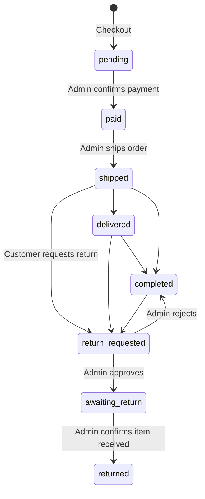

<div align="center">

# Gadget Official

**E-commerce platform for electronic gadgets with cash and installment payments**

Gadget Official is a web store for electronic gadgets. Customers browse the catalog, check out with cash or a 3, 6, or 12 month installment plan, track their orders and due dates, and request returns. Administrators manage products, orders, receivables, and returns from a dashboard, and export sales, credit, return, and recap reports as PDF. The application is a Laravel monolith with server-driven Livewire interfaces.


</div>

---

## Table of Contents

- [Features](#features)
- [Business Rules](#business-rules)
- [Tech Stack](#tech-stack)
- [Project Structure](#project-structure)
- [Getting Started](#getting-started)
  - [Prerequisites](#prerequisites)
  - [Installation](#installation)
  - [Running the application](#running-the-application)
- [Configuration](#configuration)
- [Default Accounts](#default-accounts)
- [Routes](#routes)
- [Testing and Code Style](#testing-and-code-style)
- [Troubleshooting](#troubleshooting)
- [Production Notes](#production-notes)
- [License](#license)

## Features

| Role | Capabilities |
| :--- | :--- |
| **Customer** (`user`) | Browse the product catalog. Add products to a cart and adjust quantities within available stock. Check out with a shipping address and pay in cash or by installment. View transaction history and download invoices as PDF. Track installment due dates and late fees. Request a return for an eligible order. |
| **Administrator** (`admin`) | View monthly sales, product count, and transaction count on a dashboard. Create, edit, and delete products with image upload. Move orders through payment, shipping, and completion. Record installment payments with automatic late fees. Approve or reject return requests. Review a sales recap that nets returns out of gross sales. |

**PDF exports** (Laravel DomPDF): customer invoices, sales reports with period, month, year, and payment method filters, credit reports, return reports, and the sales recap.

**Authentication** covers registration, login, email verification, password reset, and profile, password, and appearance settings. Authorization uses role middleware from Spatie Laravel Permission.

## Business Rules

| Rule | Behavior |
| :--- | :--- |
| Payment methods | `cash` or `installment` |
| Installment tenor | 3, 6, or 12 months |
| Installment interest | 5% of the cart subtotal, added once to the order total |
| Installment schedule | Equal monthly amounts, one due date per month starting one month after checkout |
| Late fee | 1% of the installment amount for each day past the due date, applied when the payment is recorded |
| Stock | Decremented at checkout. Cart quantities are capped at available stock |
| Returns | A customer can request a return when the order is `shipped`, `delivered`, or `completed` |

### Order lifecycle



## Tech Stack

| Layer | Technology | Purpose |
| :--- | :--- | :--- |
| Framework | Laravel 12 | Routing, ORM, validation, queues |
| Interface | Livewire 3, Livewire Volt, Flux UI 2 | Server-driven components |
| Client scripting | Alpine.js (bundled with Livewire) | Lightweight interactivity |
| Styling | Tailwind CSS 4, Flowbite 3 | Utility-first CSS and UI components |
| Build tool | Vite 6 | Asset bundling and dev server |
| Authorization | Spatie Laravel Permission 6 | Roles and permissions |
| PDF generation | Laravel DomPDF 3 | Invoices and reports |
| Database | SQLite (default), MySQL | Relational storage |
| Testing | Pest 3 | Feature and unit tests |
| Code style | Laravel Pint | PHP formatting |

## Project Structure

```text
gadget-official/
├── app/
│   ├── Http/Controllers/    # PDF streaming: invoice, sales, credit, return, recap
│   ├── Livewire/
│   │   ├── Admin/           # Dashboard, products, orders, sales, credit, returns, recap
│   │   ├── Auth/            # Login, registration, password flows
│   │   ├── Settings/        # Profile, password, appearance
│   │   └── ...              # Landing page, cart, transactions, installments
│   └── Models/              # User, Product, Cart, Order, OrderItem, Installment
├── database/
│   ├── migrations/
│   └── seeders/             # Roles, accounts, products, sample transactions
├── resources/views/
│   ├── livewire/            # Component views
│   └── pdf/                 # PDF templates
├── routes/                  # web.php and auth.php
└── tests/                   # Pest tests
```

## Getting Started

### Prerequisites

| Tool | Version |
| :--- | :--- |
| PHP | 8.2 or later |
| Composer | 2.x |
| Node.js and npm | Current LTS |
| Database | SQLite (default) or MySQL |

### Installation

```bash
git clone https://github.com/wildanzm/gadget-official.git
cd gadget-official

composer install
npm install
cp .env.example .env
php artisan key:generate
```

The default database is SQLite. Create the database file before migrating:

```bash
# macOS / Linux
touch database/database.sqlite

# Windows (PowerShell)
New-Item database/database.sqlite
```

To use MySQL instead, update these values in `.env`:

```dotenv
DB_CONNECTION=mysql
DB_HOST=127.0.0.1
DB_PORT=3306
DB_DATABASE=gadget_official
DB_USERNAME=root
DB_PASSWORD=
```

Run the migrations and seeders, link public storage, and build the assets:

```bash
php artisan migrate --seed
php artisan storage:link
npm run build
```

### Running the application

```bash
composer run dev
```

This starts the Laravel server, queue listener, log viewer, and Vite together. Open <http://127.0.0.1:8000>.

For a minimal setup without the queue and log processes, run `php artisan serve` after `npm run build`.

## Configuration

| Setting | Location | Default |
| :--- | :--- | :--- |
| Database connection | `.env` (`DB_*`) | SQLite |
| Session, cache, and queue driver | `.env` | `database` |
| Mail driver | `.env` (`MAIL_MAILER`) | `log` |
| Uploaded product images | `storage/app/public/products` | Served through `public/storage` |
| Interest rate and late fee | `app/Livewire/Cart.php`, `app/Livewire/Admin/Credit.php`, `app/Http/Controllers/CreditController.php` | 5% and 1% per day |

The interest rate and late fee are literal values in the code. Change them in each file listed above.

## Default Accounts

`php artisan migrate --seed` creates these accounts for local development:

| Role | Email | Password |
| :--- | :--- | :--- |
| Administrator | `admin@gmail.com` | `admin123` |
| Customer | `user@gmail.com` | `user1234` |

The seeder also creates 10 additional customers with generated Indonesian names and the password `password`, plus sample products and transactions.

> [!WARNING]
> These credentials are public. Remove or change them before deploying to any shared or production environment.

## Routes

Interface text and URLs are in Indonesian.

| Path | Access | Description |
| :--- | :--- | :--- |
| `/` | Public | Landing page and product catalog |
| `/keranjang` | Signed-in customer | Shopping cart and checkout |
| `/transaksi` | Signed-in customer | Order history and return requests |
| `/cicilan` | Signed-in customer | Installment schedule |
| `/invoice/{orderId}` | Owner of the order | Invoice PDF |
| `/admin/dashboard` | Admin | Sales overview |
| `/admin/produk` | Admin | Product list, edit, and delete |
| `/admin/produk/tambah-produk` | Admin | Create a product |
| `/admin/pesanan` | Admin | Order management |
| `/admin/tagihan` | Admin | Installments and late fees |
| `/admin/retur` | Admin | Returned items |
| `/admin/penjualan` | Admin | Sales report |
| `/admin/rekapitulasi` | Admin | Sales recap |

Each admin report page also has a `/stream` route that returns the PDF.

The `/keranjang`, `/transaksi`, and `/cicilan` routes are not wrapped in the `auth` middleware. Their queries are scoped to the signed-in user, so a guest sees empty results. Add `auth` middleware to these routes if you want guests redirected to the login page.

## Testing and Code Style

Run the test suite:

```bash
composer test
```

Tests run against an in-memory SQLite database. They cover registration, login, email verification, password reset and confirmation, and profile and password settings.

Format PHP code with Pint:

```bash
./vendor/bin/pint
```

GitHub Actions runs the tests and the linter on every push and pull request to `main` and `develop`.

## Troubleshooting

| Symptom | Likely cause | Fix |
| :--- | :--- | :--- |
| `Vite manifest not found` | Frontend assets were not built | Run `npm run build`, or use `composer run dev` |
| Product images do not appear | The public storage link is missing | Run `php artisan storage:link` |
| `unable to open database file` | The SQLite file does not exist | Create `database/database.sqlite` before migrating |
| Verification or reset emails never arrive | `MAIL_MAILER=log` writes mail to the log | Read `storage/logs/laravel.log`, or configure an SMTP driver |
| Roles are missing after migrating | Seeders did not run | Run `php artisan migrate:fresh --seed` on a development database |

## Production Notes

- Set `APP_ENV=production`, `APP_DEBUG=false`, and a unique `APP_KEY` in `.env`.
- Replace the seeded demo accounts and remove the sample transactions.
- Run a queue worker if you keep `QUEUE_CONNECTION=database`.
- Cache configuration and routes with `php artisan optimize`.

## License

Released under the MIT License.

---

<div align="center">

Maintained by [@wildanzm](https://github.com/wildanzm)

</div>
